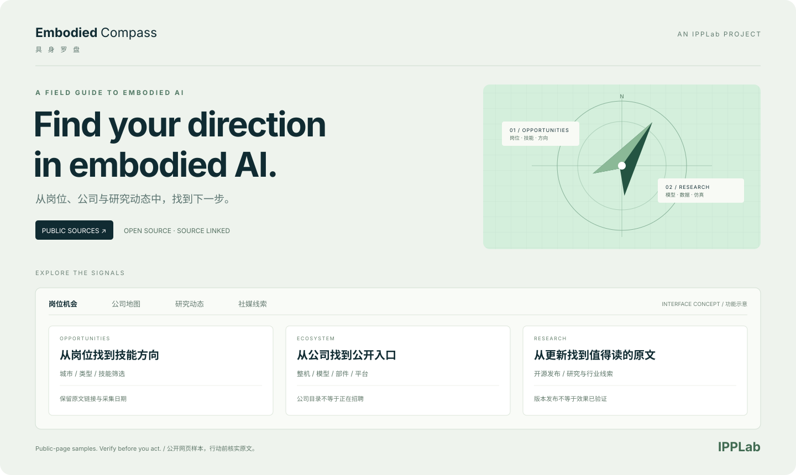

<div align="center">


# Embodied Compass · 具身罗盘

### 从信息里，找到你的具身智能方向。

把分散的 **岗位、公司和研究动态** 整理到一起，每条信息带着出处。

[打开公开网站](https://codeofwhite.github.io/embodied-intel-radar/) · [English](README.md) · [分析方法](docs/methodology.md) · [补充一个来源](https://github.com/codeofwhite/embodied-intel-radar/issues)

[](https://github.com/codeofwhite/embodied-intel-radar/actions/workflows/pages.yml)
[](https://github.com/codeofwhite/embodied-intel-radar/actions/workflows/refresh-public.yml)




<sub>图片为功能示意，不是实时页面截图。由 <strong>IPPLab</strong> 发起。</sub>

</div>

## 从一个岗位开始，看懂一个方向

想进入具身智能，往往要在招聘网站、公司官网、GitHub 发布页和社媒之间反复切换。
信息很多，但来源、时间和岗位要求容易混在一起。

具身罗盘把这些公开信息放在一张可以探索的地图里：看看有哪些岗位，要求什么技能，
哪些公司值得继续了解，相关技术最近更新了什么。每一步都可以回到原文。

## 可以用它做什么

| 入口 | 能做什么 | 如何理解结果 |
| --- | --- | --- |
| **岗位机会** | 搜公司、岗位和技能；按城市、方向、类型与官方来源筛选 | 公开页面中的岗位样本，不保证仍在招聘 |
| **公司地图** | 看公司方向，直达官网或招聘入口 | 来源目录，不代表公司当前有空缺 |
| **研究动态** | 跟进开源版本、论文与行业线索的原始来源 | 发布消息不等于效果已获独立验证 |
| **社媒线索** | 查看公开搜索索引发现的相关线索 | 单独标注待核实，不计入岗位数；没有合格线索时为空 |

公开界面可切换 **中文 / English**，原始岗位和动态保留来源语言。打开即用，无需登录。
当前采集面向国内、优先深圳，兼顾部分相邻 AI 岗位，不代表全球或全市场覆盖。
公开站不包含作者的个人技能评分、收藏、备注或私有数据库。

## 在本地打开

查看公开快照只需要 Python 3，无需安装前端依赖或编译网页。

```bash
git clone https://github.com/codeofwhite/embodied-intel-radar.git
cd embodied-intel-radar
python3 -m http.server 8080 --directory site --bind 127.0.0.1
```

浏览器打开 **<http://127.0.0.1:8080>**。这只会读取仓库里的公开快照，不会启动采集，
也不会连接作者原有的私人网站。

## 它如何保持更新

```text
公开招聘页面 / 公司来源 / 开源发布与研究索引
                    ↓
          Python 采集：限速、检查 robots.txt
                    ↓
           按字段白名单导出公开 JSON
                    ↓
       GitHub Pages：搜索、筛选、回到原文
```

GitHub Actions 每天 **北京时间 08:00** 尝试更新；实际调度可能延迟，长期不活跃的
公开仓库还可能被 GitHub 停用定时流程，页面上的真实采集时间才是判断依据。

招聘采集或导出校验失败时，保留上次成功的公开快照。事件或社媒步骤失败时，保留对应
部分和原始采集日期。流程不需要付费模型 API；使用运行环境已有的 `requests`，
依赖不可用时明确失败。

首次发布需要在 **Settings → Pages → Source** 选择 **GitHub Actions**，再运行
**Publish Compass**。[部署说明](docs/deployment.md)写明了权限、更新和维护步骤。

## 先看出处，再做判断

- **页面可访问，不等于岗位仍开放。** 投递前核对雇主原文、发布日期和截止时间；
  缺失日期、旧岗位和字段冲突保留标记。
- **岗位数是采到的样本数。** 不代表市场总量，公司目录与社媒线索不混入岗位数。
- **来源等级说明出处。** 官网也可能保留旧页面，自动提取与启发式分析都可能出错。
- **一张快照不代表趋势。** 公开流程不累积多日数据库，不声称招聘扩张、录用概率或投资价值。
- **只处理公开来源。** 不绕过登录、验证码或访问控制；保留来源链接和简短提取内容。

[统计与证据边界](docs/methodology.md) · [行业与求职阅读指南](docs/industry-guide.md) · [采集器说明](collector/README.md)

## 给开发者

`site/` 是独立公开网页。原有 `app/` React + Worker + D1 完整服务仍用于私人部署，
包含收件箱与刷新队列；这些接口没有多用户隔离，必须继续保持私有。
公开站不调用这些接口，也不改动原私人站点。

在已有 Python 3 + `requests` 开发环境中验证：

```bash
python3 -m unittest discover -s collector/tests -v
node --check site/app.js
```

本地更新数据请按[部署说明](docs/deployment.md)逐条运行公开采集命令。
采集会写本地文件并访问外部网站。不要直接用 `radar_refresh.py` 代替公开流程：
它还包含可选通知和私人服务上传步骤。

## 一起补全这张地图

欢迎补充公开招聘入口、反馈失效链接、提供可复现的解析问题、改进来源标记或无障碍体验。

[提交 Issue](https://github.com/codeofwhite/embodied-intel-radar/issues) 时，请附原始链接、
预期结果与实际情况。不要放简历、私人聊天、个人联系方式或访问凭证。

## 署名与许可

这是一个 **IPPLab** 项目。项目名称独立呈现，网站和介绍图保留 IPPLab 署名。

已有第三方代码的许可声明继续保留，见[第三方声明](docs/third-party-notices.md)。
项目统一许可证尚未选定；仓库公开不代表无限制授权转载与分发。
来源网站内容仍受各自条款约束。
